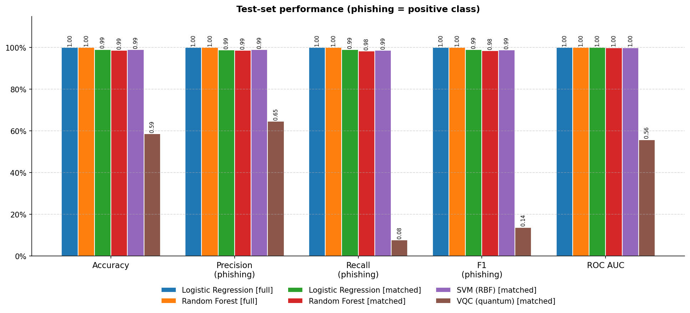
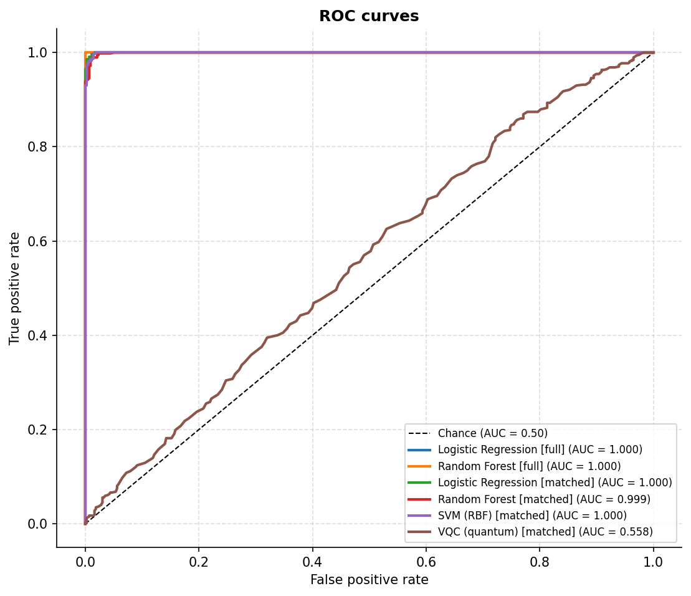
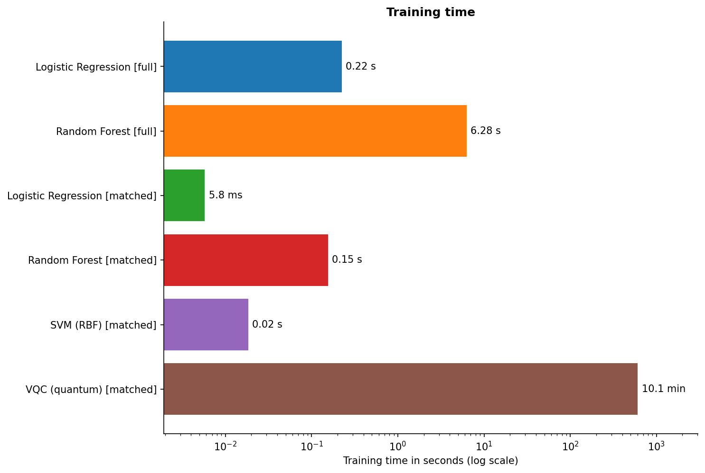
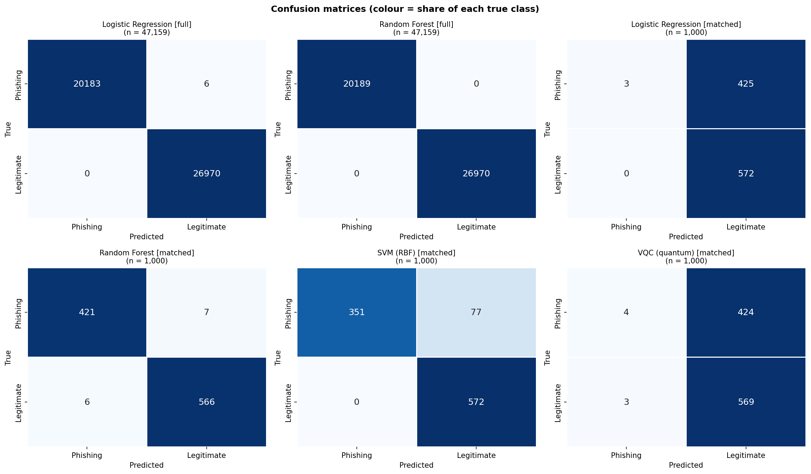
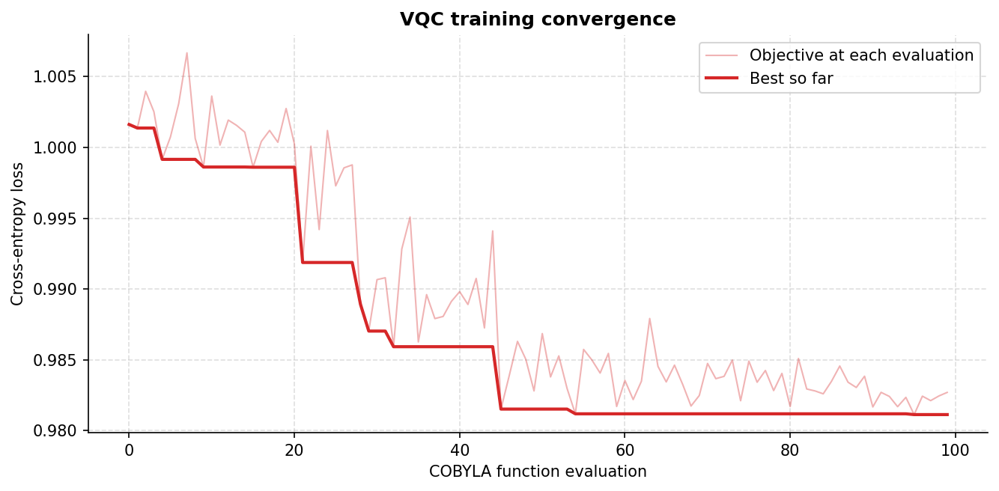

# Classical vs. Quantum Machine Learning for Phishing URL Classification


A comparison of classical machine learning models (Logistic Regression, Random Forest, RBF-SVM) against a
Variational Quantum Classifier (VQC) on the [PhiUSIIL phishing URL dataset](https://archive.ics.uci.edu/dataset/967),
using Qiskit's Aer simulator. While not to claim a quantum advantage, it can measure 
what a simulated near-term quantum classifier can and cannot do on a simple security task.

> **TL;DR:** Given identical inputs (800 training URLs, 10 PCA features), Logistic Regression, Random Forest and an
> RBF-SVM all reach 98.7 to 99.1% accuracy (ROC AUC ≥ 0.999). The VQC, in the single configuration tested, did not
> learn: its 58.7% accuracy is statistically indistinguishable from always answering "legitimate" (57.2%), it caught
> 33 of 428 phishing URLs (AUC 0.558).
> A scaling tweak showed that preprocessing improved Logistic Regression from 57.5% to 99.1% accuracy, but it did not
> significantly improve VQC.

## Results

The dataset's 235,795 URLs were split 80/20 (stratified) into 188,636 training and 47,159 test URLs; `full` means a
model trained on that entire training split. 
The `full` models are scored on the entire 47,159-URL test split. 
The `matched` models and the VQC are scored on the same 1,000-URL test subsample (428 phishing / 572 legitimate).
The McNemar tests compare every model on the shared 1,000-URL subsample. 
Precision, recall and F1 treat phishing as the positive class.

| Model | Training data | Accuracy (95% CI) | Phishing precision | Phishing recall | Phishing F1 | ROC AUC | Train time |
|---|---|---|---|---|---|---|---|
| *Always answer "legitimate" (reference)* | n/a | *57.2%* | *n/a* | *0.0%* | *0.000* | *0.500* | n/a |
| Logistic Regression | full train split (188,636) | 99.99% (99.98 to 100.00) | 100.0% | 99.97% | 0.9999 | 1.000 | 0.23 s |
| Random Forest | full train split (188,636) | 100.00% (0 errors; lower bound ≈ 99.99%)¹ | 100.0% | 100.0% | 1.0000 | 1.000 | 6.2 s |
| Logistic Regression | matched (800) | 99.1% (98.5 to 99.6) | 98.8% | 99.1% | 0.989 | 0.9998 | 6.5 ms |
| Random Forest | matched (800) | 98.7% (97.9 to 99.3) | 98.6% | 98.4% | 0.985 | 0.9993 | 0.15 s |
| SVM (RBF) | matched (800) | 99.0% (98.3 to 99.6) | 99.1% | 98.6% | 0.988 | 0.9996 | 7.0 ms |
| **VQC (quantum)** | matched (800) | **58.7% (55.7 to 61.7)** | 64.7% | 7.7% | 0.138 | 0.558 | 569 s (9.5 min) |

¹ With zero errors the bootstrap interval collapses to a single point, which
understates the uncertainty; a standard one-sided 95% bound for zero errors in 47,159 URLs puts accuracy at no less
than about 99.99%.

Intervals are 95% bootstrap confidence intervals (2.5th to 97.5th percentile of 5,000 resamples of the test set); they
capture test-set sampling noise only. 




| ROC curves | Training time |
|---|---|
|  |  |

| Confusion matrices | VQC training loss |
|---|---|
|  |  |

More figures (class balance, correlations, PCA scree, confusion matrices, VQC convergence, feature
importance) are in [`results/figures/`](results/figures/).
Raw tables: [`metrics_summary.csv`](results/metrics_summary.csv), [`mcnemar_vs_vqc.csv`](results/mcnemar_vs_vqc.csv).

## Preprocessing tweak: min-max vs. percentile clipping
 
An initial run scaled the 10 PCA features to [0, 1] with min-max scaling, and the matched Logistic Regression and the
VQC both collapsed to predicting "legitimate" for almost every URL. When analyzing the 800-URL training subsample, 
it revealed a few extreme outliers that set the min and max, causing the 1st to 99th percentile of each feature to span only
0.02 to 0.09 of the [0, 1] range (mean about 0.05).
 
When min-max scaling was replaced with percentile clipping (1st to 99th percentile mapped to [0, 1], fit on the training set only) and
reran:
 
| Model (matched, 800 URLs) | Min-max: accuracy / phishing recall / AUC | Percentile clip: accuracy / phishing recall / AUC |
|---|---|---|
| Logistic Regression | 57.5% / 0.7% / 0.9994 | **99.1% / 99.1% / 0.9998** |
| Random Forest | 98.7% / 98.4% / 0.9993 | 98.7% / 98.4% / 0.9993 |
| SVM (RBF) | 92.3% / 82.0% / 0.9995 | **99.0% / 98.6% / 0.9996** |
| VQC | 57.3% / 0.9% / 0.557 | 58.7% / 7.7% / 0.558 |
 
- While Logistic Regression already ranked URLs near-perfect under min-max (AUC 0.9994), its decision threshold was off; percentile clipping improved it.
- Random Forest was unaffected, as expected for a model that depends on the order of values, not their scale.
- VQC was largely unaffected (AUC 0.557 to 0.558). Input scaling is therefore not what holds it back.
The min-max results are kept in [`results/ablation_minmax/`](results/ablation_minmax/). To reproduce them, replace the
clipping lines in `prepare_quantum_inputs` with `MinMaxScaler(feature_range=(0, 1))`.


## Note on QML vs. ML

A VQC executed through simulated qubits can only be trained on a small portion of the data, with one qubit per feature.
Comparing it to classical models trained on every row and feature would exhibit an unfair comparison of big data vs small data. 
To help negate this, each classical model is evaluated under two regimes:

- **`full`**: trained on the entire training split (188,636 URLs, 80% of the dataset). 
- **`matched`**: trained on the same stratified subsample and the same PCA features as the VQC.

All models are scored on the same shared test subsample, and 95% bootstrap confidence intervals for
accuracy. A McNemar test (`results/mcnemar_vs_vqc.csv`) was used to check whether the VQC's errors
differ significantly from each classical model's errors on the same URLs.

## Method

| Step | Detail |
|---|---|
| Data | PhiUSIIL: 235,795 URLs (42.8% phishing, 57.2% legitimate); 50 numeric features (the text columns URL, Domain, TLD and Title are excluded). 80/20 stratified split. |
| Preprocessing | `StandardScaler` fit on train only -> PCA to 10 components (56.8% of variance) -> percentile-clip scaling to [0, 1] (1st to 99th percentile, fit on train only) for angle encoding. |
| Classical | Logistic Regression, Random Forest (100 trees), RBF-SVM (matched regime only: kernel SVMs scale quadratically with data). All use default hyperparameters. |
| Quantum | `zz_feature_map` (reps=1, full entanglement) + `real_amplitudes` ansatz (reps=1, 20 trainable weights), 10 qubits. |
| Optimiser | COBYLA, `maxiter=100`, cross-entropy loss. |
| Simulator | Qiskit Aer (`SamplerV2`), 1,024 shots, fixed seed. Noiseless. |
| Reproducibility | A single `RANDOM_SEED` drives the split, subsampling, models, PCA and the quantum sampler. |

## Findings

1. The underlying signal persists in the subsample: With only 800 training URLs and 10 PCA components, all three classical
   models reach 98.7 to 99.1% accuracy with ROC AUC ≥ 0.999. Because their confidence intervals overlap, the performance ranking
   between classical models is undifferentiated.
2. The VQC did not learn in this configuration. Its 58.7% accuracy (95% CI 55.7 to 61.7%) is statistically
   indistinguishable from the 57.2% of always answering "legitimate". It caught 33 of 428 phishing URLs and its AUC
   is 0.558, barely above random chance. Training accuracy (59.4%) is close to test accuracy (58.7%), which points to
   underfitting. All five McNemar comparisons against the classical models are statistically significant
   (p < 0.001).
3. Classical models reach about 99% on the exact same inputs, and the task is nearly
   linearly separable (Logistic Regression AUC 0.9998), so the VQC's underfitting points to the circuit and its training
   rather than a lack of signal.
4. Preprocessing mattered a great deal for the classical baselines (Logistic Regression 57.5% to 99.1%, SVM 92.3%
   to 99.0%) but not for the VQC (see the experiment above).
5. Cost. The VQC took 569 s versus 0.15 s for the Random Forest on identical data (about 3,700x), and 80,000x or
   more than Logistic Regression or the SVM.

## Challenges

- Quantum simulators vs. quantum hardware: Results are noiseless; real quantum devices add gate and readout noise.
- Quantum budget: The VQC uses 800 training samples and 10 PCA components, so absolute accuracy is
  not comparable to the full-data models (which is why the matched baselines were used).
- Classical models score very high on PhiUSIIL, which leaves little room to separate model
  families. Several features are derived from page content and URL similarity, which can make the task easier than URL-only detection.

## Reproduce

```bash
git clone https://github.com/ncapodieci213/qml-url-classification.git
cd qml-url-classification

python -m venv .venv
# macOS/Linux:  source .venv/bin/activate
# Windows:      .venv\Scripts\activate
pip install -r requirements.txt

python main.py          # downloads the dataset automatically; writes ./results/
```

Runtime will vary based on machine (mostly by VQC training; tune `VQC_MAXITER`, `QUANTUM_TRAIN_SIZE`,
`N_QUBITS` at the top of `main.py`).

## Repository structure

```
qml-url-classification/
├── main.py                          # writes to ./results/
├── requirements.txt
├── results/
│   ├── figures/                     # 9 graphs
│   ├── metrics_summary.csv          # quick summary of one row per model
│   ├── mcnemar_vs_vqc.csv           # paired significance tests
│   ├── predictions_matched.csv      # per-URL predictions + scores, all models, defanged URLs
│   ├── hard_examples.csv            # URLs most classical models get wrong
│   └── ablation_minmax/             # results from the original min-max scaling run
└── README.md
```


## Data and references

- PhiUSIIL Phishing URL Dataset, UCI Machine Learning Repository: https://archive.ics.uci.edu/dataset/967
- Qiskit: https://qiskit.org, Qiskit Machine Learning: https://qiskit-community.github.io/qiskit-machine-learning/
